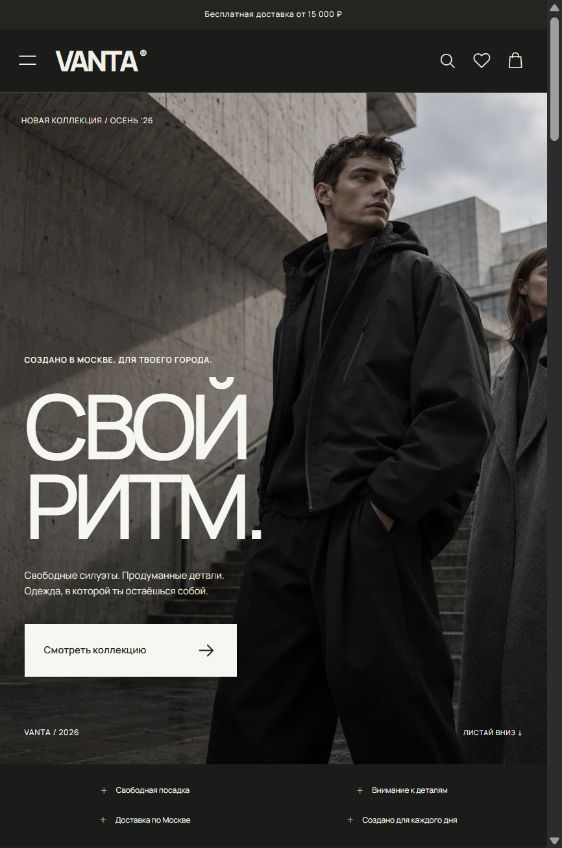

# VANTA — одежда в ритме Москвы

Полноценный демонстрационный интернет-магазин для портфолио: оригинальный fashion-дизайн, 24 товара, русский интерфейс и цены в рублях.

[Открыть сайт](https://vanta-moscow.donnawrightp243.chatgpt.site/) · [Кейс для портфолио](docs/Портфолио.md)



## Быстрый запуск

```sh
git clone https://github.com/AndryFors/vanta-moscow.git
cd vanta-moscow
node server.mjs
```

Дважды нажмите **start.cmd** в этой папке. Откройте **http://127.0.0.1:4186**. Окно сервера должно оставаться открытым.

Или выполните из папки проекта:

```powershell
node server.mjs
```

Нужен Node.js 20 или новее. Установка зависимостей для запуска не требуется. Открывать index.html напрямую через file:// нельзя: каталог загружается через HTTP.

## Готовая сборка

```powershell
node scripts/build.mjs
node server.mjs --dist
```

`dist/` — готовый статический сайт. На хостинге требуется перенаправлять маршруты без расширения на index.html; для Netlify/Cloudflare Pages добавлен файл `_redirects`. Адрес публичной версии: https://vanta-moscow.donnawrightp243.chatgpt.site. Open Graph настроен на этот адрес.

## Что работает

- Каталог из JSON: категории, диапазон цены, размеры, цвета, коллекции, наличие, новинки, скидки; параметры в URL и шесть сортировок.
- Поиск с задержкой 350 мс, избранное и история просмотра.
- Страница товара, две фотографии, галерея с клавиатурой и свайпом, увеличение, таблица размеров и быстрый просмотр.
- Остатки по сочетаниям цвета и размера; объединение одинаковых вариантов; защита от превышения наличия.
- Корзина и выезжающая панель, единый расчёт суммы, промокоды, восстановление после перезагрузки.
- Три этапа оформления с валидацией, доставка по Москве, тестовые способы оплаты, номер и сохранённая сводка заказа.
- Светлая/тёмная тема, мобильное меню и фильтры, уведомления, состояния загрузки, ошибок, пустых списков и 404.
- Семантический HTML, клавиатурная навигация, нативные диалоги, Escape, возвращение фокуса и уменьшение анимации.

## Демонстрация клиенту

1. Откройте главную и покажите коллекцию.
2. В каталоге объедините категорию, размер и цвет, обновите страницу — фильтры сохранятся.
3. Добавьте вещь в избранное; откройте быстрый просмотр и выберите размер.
4. Добавьте тот же вариант второй раз — количество объединится. Другой размер создаст отдельную строку.
5. В корзине примените `VANTA10`, `WELCOME15` или `FREESHIP`.
6. Оформите заказ с тестовыми данными: Даниил Иванов, test@example.ru, +7 999 123-45-67, Москва, 119001, Арбат, 10.
7. Переключите доставку, покажите изменение стоимости и завершите демонстрационный заказ.

## Архитектура

`src/app.js` — маршрутизация и события; `catalog.js` — фильтры и сортировка; `store.js` — корзина, остатки и цена; `storage.js` — безопасное хранение; `pages.js` — страницы; `product.js` — товар и галерея; `checkout.js` — оформление; `validation.js` — формы; `components.js` — общие компоненты; `modal.js` — диалоги и уведомления; `utils.js` — форматирование и безопасные шаблоны.

`data/products.json` — данные товаров. `assets/` — все фотографии и локальный шрифт. `scripts/create-data.mjs` воспроизводит исходный каталог, поэтому его запуск заменяет изменения в JSON. Сборка не требует повторной генерации данных или изображений.

## Проверки

```powershell
node --test tests/core.test.mjs
```

Браузерная проверка: `node tests/browser.cjs`, визуальная: `node scripts/screenshots.cjs`. Для них нужен Playwright и установленный Microsoft Edge. При использовании внешнего пакета задайте `VANTA_PLAYWRIGHT_PATH` как путь к модулю Playwright. Проверки бизнес-логики не требуют сторонних пакетов.

## Материалы проекта

- [Адаптированное ТЗ: Россия, Москва](docs/ТЗ-Россия-Москва.md)
- [Кейс для портфолио](docs/Портфолио.md)
- [Результаты проверки](docs/QA.md)
- [Происхождение изображений](docs/Изображения.md)

## Границы демонстрации

Реальная оплата, доставка, отправка заказов и писем отсутствуют. Контакты бренда, товары, остатки и отзывы концептуальные. Подписка и формы сохраняются только в вашем браузере. Банковские данные не вводятся и не хранятся. Очистить данные можно в разделе конфиденциальности в подвале.

Товарные фотографии созданы специально для проекта. Вторые цвета представлены образцами и могут отличаться от показанной съёмки; основной цвет указан на странице. При коммерческом запуске потребуются реальные товары, контакты, backend, платёжный провайдер, юридические документы и фотографии всех вариантов. Метаданные SPA меняются в браузере; для полной поисковой индексации потребуется SSR или предварительная генерация страниц.
